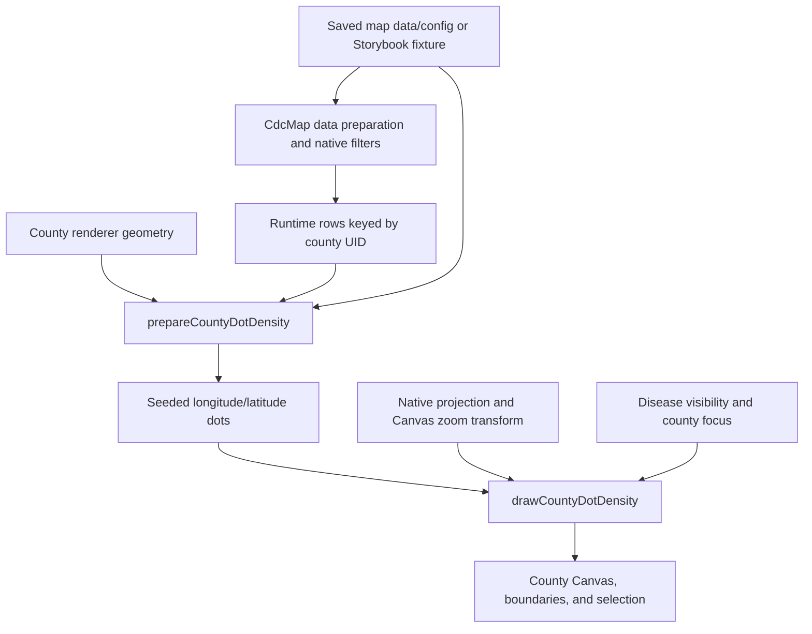

# County Dot Density Maps

Developer context for the county dot density layer and its first editor integration in `@cdc/map`.

Use this document when working on county dot placement, multiple disease series, the Canvas integration, filter and zoom behavior, or the editor and saved-config contract.

## Current Status and Scope

The editor-authored layer and the Storybook prototype both render through the existing `CdcMap` → `UsaMap.County` Canvas path. Neither creates its own Canvas, projection, or zoom implementation.

- Supported authoring surface: `general.geoType === 'us-county'`, with developer mode enabled using `?isCoveDeveloper=true` (or `&isCoveDeveloper=true` on an existing query string). The Map Type option, its help text, and density editor section are hidden otherwise. Saved density maps still render without the flag.
- Saved settings: `config.dotDensity`, activated through **Type → Map Type → Dot Density** when **US County-Level** is selected; authored in the **Dot Density** section.
- Existing maps default to `enabled: false`; no shared migration or new dependency is needed for the additive opt-in field.
- `CountyDotDensityContext` remains a prototype override, defaulting to `null`. It takes precedence over saved settings when supplied.
- The ordinary county map retains its existing rendering path while density is disabled.
- The outbreak fixture contains invented measles, salmonellosis, and pertussis counts for Arizona counties during one shared simulated reporting period.

The consumer-facing fields are documented in [`packages/map/CONFIG.md`](../packages/map/CONFIG.md#dotdensity). The prototype Context shape below is internal and is not a saved configuration API.

## Encoding Contract

Each dot represents the same fixed quantity across counties and series:

```text
county/series dot count = floor(count / dotValue)
```

For example, 32 cases at five cases per dot produces six dots. The two-case remainder is retained in the tooltip/table total but has no dot. Rounding happens independently for each county and disease, so aggregate displayed dots can underrepresent the aggregate count. The count helper corrects floating-point division error extremely close to a whole number (for example, 33 / 1.1 produces 30 dots); genuine remainders still round down.

Dot centers are approximate positions sampled inside the county geometry. They do not identify individual people or case locations. Placement is uniform by spherical area within the supplied geometry; it does not use population density, land-use data, or an additional water mask. Existing polygon holes are respected.

The examples encode counts, not population-adjusted rates. A denser cluster on this map alone does not establish greater individual risk. The legend and exact totals are part of the interpretation, not optional decoration.

## Key Files

| File                                                                                                               | Responsibility                                                                                                      |
| ------------------------------------------------------------------------------------------------------------------ | ------------------------------------------------------------------------------------------------------------------- |
| [`CountyDotDensityContext.ts`](../packages/map/src/context/CountyDotDensityContext.ts)                             | Experimental settings and visibility injection.                                                                     |
| [`dotDensityConfig.ts`](../packages/map/src/helpers/dotDensityConfig.ts)                                           | Default hydration, eligibility, stable series creation, and temporary tooltip/table columns.                        |
| [`DotDensityEditorSection.tsx`](../packages/map/src/components/EditorPanel/components/DotDensityEditorSection.tsx) | County-only authoring controls and series mappings.                                                                 |
| [`DotDensityLegend.tsx`](../packages/map/src/components/DotDensityLegend.tsx)                                      | Authored runtime legend and nonpersisted visibility toggles.                                                        |
| [`dotDensity.ts`](../packages/map/src/helpers/dotDensity.ts)                                                       | Pure quantity validation and seeded geographic sampling.                                                            |
| [`countyDotDensityLayer.ts`](../packages/map/src/helpers/countyDotDensityLayer.ts)                                 | Joins runtime rows to counties, prepares category dots, and draws using the supplied production projection/context. |
| [`UsaMap.County.tsx`](../packages/map/src/components/UsaMap/components/UsaMap.County.tsx)                          | Owns geometry loading, projection, Canvas sizing, focus, zoom, selection, and layer ordering.                       |
| [`CountyDotDensityPrototype.tsx`](../packages/map/src/_stories/dotDensity/CountyDotDensityPrototype.tsx)           | Builds synthetic map config and renders `CdcMap` inside the provider.                                               |
| [`OutbreakLegend.tsx`](../packages/map/src/_stories/dotDensity/OutbreakLegend.tsx)                                 | Story-only labeled disease toggles and exact fixture totals.                                                        |
| [`outbreakData.ts`](../packages/map/src/_stories/dotDensity/outbreakData.ts)                                       | Synthetic disease definitions, colors, and county counts.                                                           |
| [`CdcMap.DotDensity.stories.tsx`](../packages/map/src/_stories/CdcMap.DotDensity.stories.tsx)                      | Examples, deterministic topology mocking, and browser regression coverage.                                          |

## Persisted Editor Settings

`dotDensity` stores `enabled`, `dotValue`, `radius`, `seed`, `unit`, and `series: [{ id, column, label, color }]`. Defaults are disabled, 100 units per dot, a 1.5-pixel radius, seed 42, unit `cases`, and no series. Legend visibility, title, description, position, style, border, and layout use the standard `general.showSidebar` and `legend` controls.

The editor creates a UUID-based series ID once when the author adds a series. Keep this identity across label, color, column, or ordering edits; changing an ID changes its placement sequence. IDs do not depend on source-column names and are not reused when a series is removed and replaced. Initial series colors cycle through the existing shared colorblind-safe palette. The per-series color picker persists a literal color rather than introducing another versioned palette setting.

The Map Type dropdown offers Dot Density only for US county geography. Its displayed selection is derived from the existing data-map type and `dotDensity.enabled`; no new persisted map type is introduced. The settings section appears only while density is active. Selecting Data or another map type disables density without deleting its settings. Switching geography retains the stored settings but makes the layer inactive. An enabled layer needs geography and at least one mapped count series. Blank series are drafts and do not render; mapped columns absent from available data produce a required-field prompt. That prompt opens the Dot Density section and prioritizes a mapped-but-missing column over an unrelated blank draft. Validation and editor dropdowns share `getAvailableMapColumns`, which collects the union of keys across embedded rows or the assigned dashboard dataset, so a missing count in the first row does not invalidate later rows.

`getDotDensityConfig` fills optional defaults without changing the input. `withDotDensityColumns` adds distinct count fields to temporary tooltip/table configs, preserving existing authored column metadata and avoiding key collisions. These generated mappings are not saved back to `config.columns`.

The standard editor save path preserves `dotDensity`. The authoring Storybook harness exercises the existing export cleanup (`stripConfig`) and reloads the serialized map. Runtime visibility, generated dots, and caches are not stored in the density object.

## Prototype Runtime Override

The provider supplies this internal contract:

```ts
type CountyDotDensityOptions = {
  settings: {
    dotValue: number
    seed: number
    series: readonly {
      id: string
      column: string
      color: string
    }[]
  }
  radius: number
  hiddenSeries: readonly string[]
  initialStateCode?: string
}
```

`column` names a count field on the existing runtime row; the row is already keyed by county geography UID. Series IDs must be stable and unique. They identify visibility toggles and participate in the placement seed. Production labels come from `dotDensity.series[].label` with a source-column fallback; the prototype has its own fixture labels.

`initialStateCode` initializes native county-map focus through the existing reducer action and clears county selection. It is reapplied when that input changes, not on every render. Native Reset Zoom can therefore return to the nationwide view without the prototype immediately forcing the initial state again.

A density-only map may leave `columns.primary.name` empty for a neutral base. A configured primary column keeps the choropleth beneath the dots. The editor accepts a configured density series in place of the primary-column requirement, while still requiring geography. The county renderer permits either an authored or injected layer to render without choropleth legend items.

## Data and Render Flow



### Preparation

`UsaMap.County` memoizes preparation against `densitySettings`, `topoData.counties`, and `runtimeData`. Keep the settings object stable: replacing it unnecessarily regenerates dots even when its contents are equivalent.

`prepareCountyDotDensity` matches geometry IDs to existing runtime rows. Unmatched rows cannot draw dots; counties without a matching row are skipped. The normal data pipeline remains responsible for geography assignment and filtering. Changing those runtime rows regenerates the prepared layer; hiding a disease or changing the view does not.

Preparation combines all county/series requests before allocation and returns `{ dots, error, signature, skippedValues }`. The signature contains the first three coordinates for each county/series; it is a regression aid, not a checksum of every dot.

### Drawing and Layer Order

`drawCountyDotDensity` receives the county renderer's exact projection and already-transformed Canvas context. It must not fit another projection, resize the Canvas, or install separate zoom listeners.

The integration paints the base county shapes first, then the dots. Selected-county, HSA, and state/focus boundary strokes follow the dot layer. County boundary strokes are part of the earlier base pass. When a selected county needs its fill repainted, that fill is painted before the dots so selection does not erase them. Other native custom-layer/highlight logic retains its established ordering.

Dot radius is divided by zoom scale before drawing, preserving apparent radius during zoom. Dot value stays fixed across zoom levels. The projection is applied during each draw; projected dot coordinates are not currently cached between zoom frames.

The existing zoom listener can outlive the render that installed it. `drawCanvas` updates `renderFrameRef`, and scheduled animation frames call that ref. Preserve this connection: otherwise a disease toggle can appear correct initially and then revert when the next zoom frame uses an older closure.

## Placement and Determinism

`generateDensityDots` uses D3's seeded `randomLcg` generator. The county layer passes `${countyId}:${seriesId}` as the feature ID, giving each county/disease an independent random sequence.

For each point, the sampler:

1. Selects a polygon component by its spherical area.
2. Samples longitude and sine(latitude) uniformly within that component's geographic bounds.
3. Handles a bounding box crossing the antimeridian by wrapping longitude.
4. Rejects candidates outside the polygon using `geoContains`, including polygon holes.

Selecting the component before rejection sampling prevents bounding-box acceptance rates from changing the relative island weights. Uniform latitude sampling would introduce a different area distribution.

The bundled geometry follows D3's spherical polygon winding convention. The helper is not a general-purpose geometry repair/normalization service; its small spherical polygon tests use clockwise outer rings and counterclockwise holes.

For unchanged geometry, count settings, seed, and series ID, geographic coordinates remain stable across redraw, resize, zoom, and disease visibility changes. Filtering out another county does not change a retained county's sequence. Changing geometry can change positions; changing a series ID intentionally changes its sequence. The seed is currently coerced to a 32-bit integer internally, so distinct fractional seeds need not produce distinct results.

Prepared dots are sorted into a deterministic mixed paint order. Series order contributes to this order, while coordinate generation uses series identity. This reduces systematic category-on-top bias; it does not prevent dot overlap or guarantee every dot remains distinguishable.

## Limits and Edge Cases

| Condition                                                               | Current behavior                                                                                                       |
| ----------------------------------------------------------------------- | ---------------------------------------------------------------------------------------------------------------------- |
| Nonpositive/nonfinite dot value or nonfinite seed                       | Layer preparation returns an error and no dots.                                                                        |
| Negative, missing, nonfinite, or nonnumeric count                       | Contributes no dots and increments the omitted-value status. The source value is retained for tooltip/table rendering. |
| Invalid radius                                                          | Drawing submits no dots and reports an error.                                                                          |
| More than 100,000 requested dots across matched counties and all series | Entire layer is rejected with an instruction to increase dot value. There is no silent thinning.                       |
| Sampling shortfall                                                      | Entire layer is rejected; no partial distribution is shown.                                                            |
| Hidden series or county excluded by native focus                        | Drawing skips its dots without regenerating coordinates.                                                               |
| All diseases hidden                                                     | Geography remains, with a clear selection status.                                                                      |
| No outbreak fixture for a county                                        | Storybook omits that row instead of inventing a zero-case observation.                                                 |

The budget includes hidden diseases and counties outside the current state focus if their rows are still in runtime data. Hiding a disease or zooming into a state does not bypass the preparation budget. The sampler defaults to a 100,000-dot limit and 1,000,000 candidate attempts per county/series call; this is not a global sampling-time limit.

Canvas attributes `data-drawn-dots`, `data-series-counts`, `data-position-signature`, and `data-density-error` support browser checks. Submitted-dot counts are not counts of individually visible, unobscured pixels: Canvas clipping and overlap still apply. The map does not display a dot-count status above the Canvas. Errors, omitted-value warnings, and the all-series-hidden status remain visible.

The production density legend renders inside the standard `Legend` container, rather than above the county Canvas. `hiddenDensitySeries` lives in the map reducer so the legend and county renderer share runtime visibility; it is never saved in config. The standard Show All action clears it. Enabled county-density legacy `dotDensity.legend` imports are normalized once before applying defaults (or on activation), transferring visibility and title to shared fields and removing the old object. Explicit nonempty shared titles take precedence.

The production legend shows series labels; its toggles change drawing only. Explanatory text comes from the standard Legend Description input; the density legend adds no built-in narrative or quantity key. The old unit label control is removed; saved `dotDensity.unit` values are retained for compatibility and do not generate text. Native filters, tooltip values, table data, and saved configuration are not changed by category toggles. The prototype legend additionally shows full-fixture totals, which do not change with native state/county selection. When a source field is already authored in `config.columns`, its existing display metadata takes precedence over generated density metadata.

## Storybook and Verification

Import [`examples/dot-density-outbreaks.json`](../packages/map/examples/dot-density-outbreaks.json) into the updated editor for a ready-configured synthetic Arizona map. The companion [`CSV`](../packages/map/examples/dot-density-outbreaks.csv) contains the same 15 county rows for data-import practice. Select Arizona under **Select Location** to focus the map. `ImportableSample` in the editor stories loads that exact JSON file.

Find the stories under **Components → Templates → Map → Dot Density Prototype**. Start with `DiseaseOutbreaks`, `DenseDiseaseOutbreaks`, and `CountySelection`. Population, nationwide, resize, empty, missing-fixture, and budget examples are also available.

The file's `beforeEach` intercepts the county-topography request and supplies the bundled 2019 topology; cleanup restores `fetch`. This makes the examples deterministic while exercising the production loader and renderer.

```sh
yarn storybook
yarn test-unit:quick -- --scope @cdc/map -- src/helpers/tests/dotDensity.test.ts src/helpers/tests/countyDotDensityLayer.test.ts src/helpers/tests/dotDensityConfig.test.ts src/helpers/tests/getMissingRequiredMapFields.test.ts
yarn test-storybook:quick packages/map/src/_stories/CdcMap.Editor.DotDensity.stories.tsx packages/map/src/_stories/CdcMap.DotDensity.stories.tsx packages/map/src/_stories/CdcMap.Zoom.stories.tsx
```

Unit coverage lives in [`dotDensity.test.ts`](../packages/map/src/helpers/tests/dotDensity.test.ts), [`countyDotDensityLayer.test.ts`](../packages/map/src/helpers/tests/countyDotDensityLayer.test.ts), and [`dotDensityConfig.test.ts`](../packages/map/src/helpers/tests/dotDensityConfig.test.ts). It covers quantity handling, deterministic placement, containment, holes, multipolygon weighting, the antimeridian, allocation limits, runtime-row matching, category independence, projection use, visibility, and zoom radius.

Browser coverage checks actual Canvas colors/output, native zoom/reset, resize, category toggles, county tooltip fields, selection highlighting, hidden categories during later zoom frames, the table, and empty/error states. Run the existing zoom stories alongside the dot stories after changing the shared renderer. Use the shared interaction helpers from [Testing Best Practices](TESTING_BEST_PRACTICES.md).

## Editor Verification and Remaining Hardening

The editor stories live under **Components → Templates → Map → Editor Tests → Dot Density** in [`CdcMap.Editor.DotDensity.stories.tsx`](../packages/map/src/_stories/CdcMap.Editor.DotDensity.stories.tsx). They cover enabling the layer, mapping multiple fields, label/color changes, value per dot, radius, seed and legend title, legend visibility, removing series, disabling/re-enabling, neutral maps, tooltip/table fields, and saving/reloading actual authored JSON with stable IDs. Unit coverage also checks legacy disabled defaults and migration/default hydration.

The following remain deliberate follow-up work rather than guarantees of this first editor implementation:

- Benchmark generation, memory, projection, and frame time on representative devices. The 100,000-dot cap is an experimental bound, not a demonstrated performance guarantee. Evaluate projected-coordinate caching or worker-based preparation against measured needs.
- Exercise full dashboard authoring/filter orchestration and column-replacement UI scenarios. The current implementation consumes the existing filtered runtime rows; the Data Import remapper already walks exact string references such as `series[].column` (see [Column Remap System](COLUMN_REMAP_SYSTEM.md)).
- Verify image/PDF export and a dedicated accessibility matrix. Native Canvas reuse and labeled series toggles are useful foundations, not proof of every export or assistive-technology scenario.
- Reassess whole-dot flooring and remainder messaging with product/QA. This implementation retains the prototype policy; authors can explain quantity and remainder handling through Legend Description.
- Consider whether additional legend totals are useful and explicitly define their scope before adding them. Production legend toggles currently show labels without a second aggregation.

Keep the package config reference in sync with future authorable changes. Read [Config Documentation Guide](CONFIG_DOCUMENTATION_GUIDE.md), and read [Migration System](MIGRATION_SYSTEM.md) before adding any shared migration. No migration was added for this opt-in field because default hydration keeps existing configs disabled.

Related context: [Bubble Layers](BUBBLE_LAYERS.md) for layer authoring patterns, [Dashboard Filters Flow](DASHBOARD_FILTERS_FLOW.md) for orchestration, and [Package Dependencies](PACKAGE_DEPENDENCIES.md) for package boundaries.
